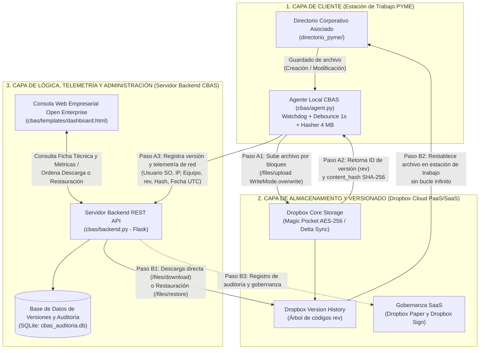
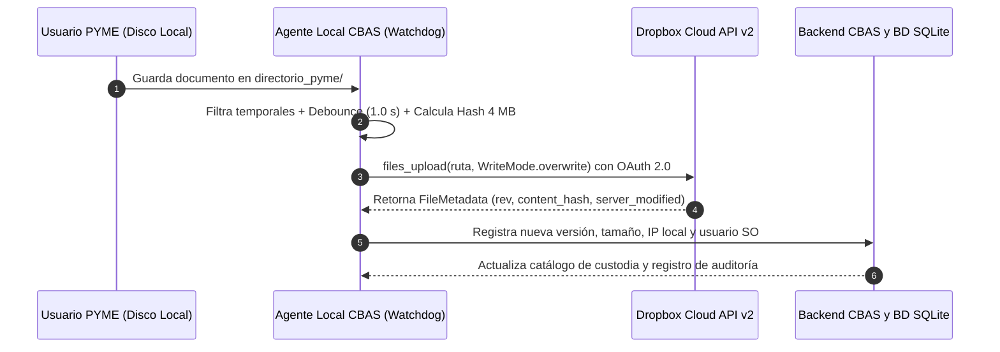
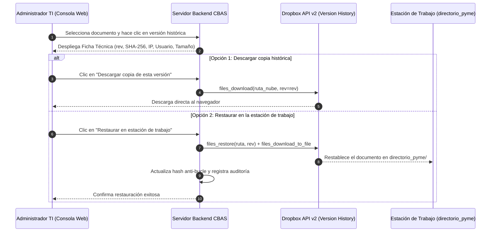
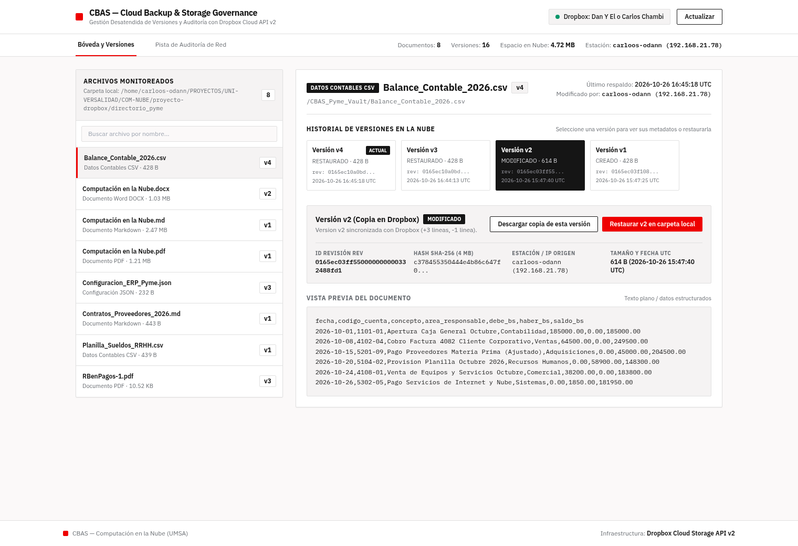
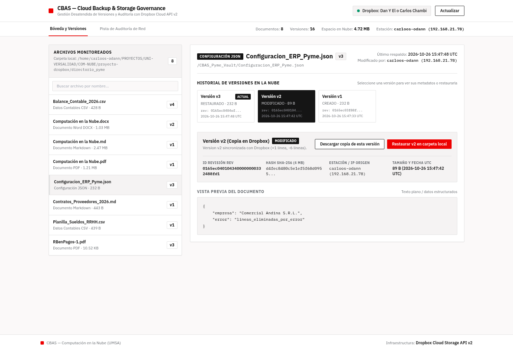
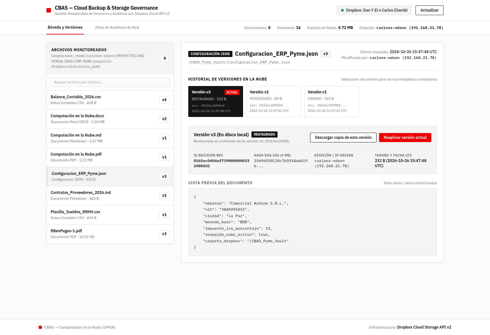
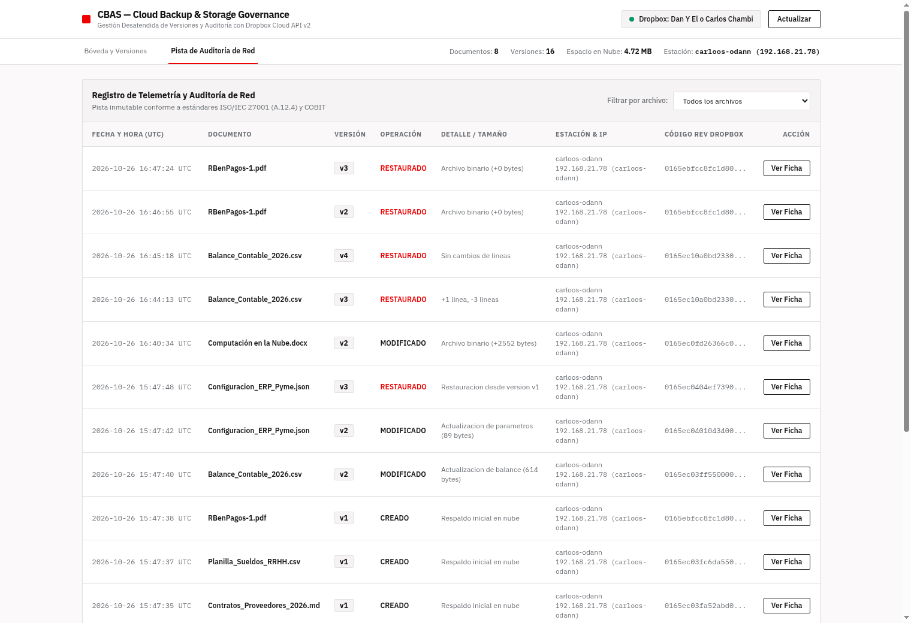

**UNIVERSIDAD MAYOR DE SAN ANDRÉS**  
**FACULTAD DE CIENCIAS PURAS Y NATURALES**  
**CARRERA DE INFORMÁTICA**  
![][image1]

**Materia: Computación en la Nube**

**Proyecto Cloud Computing: Ecosistema Dropbox**

## ***"CLOUD BACKUP AND AUDIT SYSTEM (CBAS): SISTEMA DE RESPALDO DESCENTRALIZADO Y CONTROL DE VERSIONES PARA PYMES BASADO EN DROPBOX CLOUD API"***

**INTEGRANTES (GRUPO N° 2):**  
1\. Univ. Choquehuanca Huanca Saul Mijael  
2\. Univ. Quispe Chambi Carlos Daniel  
3\. Univ. Quispe Rojas Victor Bernardo  
4\. Univ. Yujra Machaca Gabriel

**DOCENTE:** Ph.D. JOSE MARIA TAPIA BALTAZAR  
**FECHA:** Octubre de 2026

**La Paz \- Bolivia**  
**2026**

---

# **I. PRIMERA PARTE: FUNDAMENTACIÓN TEÓRICA Y PROBLEMÁTICA (30%)**

# **1\. INTRODUCCIÓN**

En el entorno empresarial contemporáneo, las Pequeñas y Medianas Empresas (PYMEs) enfrentan dos desafíos críticos respecto a la seguridad y continuidad de sus activos de información: la **pérdida de datos** ocasionada por errores humanos involuntarios o ataques de secuestro de información (*ransomware*), y la **ausencia de trazabilidad (auditoría)** sobre quién modifica los documentos críticos del negocio, desde qué terminal y en qué instante exacto.

Las herramientas tradicionales de control de versiones procedentes de la ingeniería de software (como Git) resultan excesivamente complejas y ajenas para usuarios de áreas operativas no técnicas, tales como contadores, administradores financieros, analistas de recursos humanos o gestores de contratos. En el extremo opuesto, diseñar e implementar desde cero una arquitectura de almacenamiento masivo, redundante y seguro sobre infraestructuras de nube pura (como Amazon AWS S3 o Microsoft Azure Blob Storage) exige configuraciones avanzadas de políticas de identidad (IAM), reglas de ciclo de vida y costos de administración técnica que superan el presupuesto operativo de una PYME.

Frente a esta realidad, es indispensable comprender que **Dropbox** no es un simple disco duro virtual para guardar archivos manualmente ni un sustituto pasivo de herramientas ofimáticas como Google Drive. Dropbox constituye una plataforma tecnológica integral de **Computación en la Nube (SaaS y PaaS)** respaldada por su propia infraestructura física distribuida a escala de exabytes (**Magic Pocket**), un motor de sincronización diferencial a nivel de bloques de 4 MB (**Delta Sync**), un libro mayor transaccional e inmutable de historial de versiones (**Version History**) y un ecosistema empresarial que abarca colaboración en tiempo real (**Dropbox Paper**), firma electrónica con validez jurídica (**Dropbox Sign**) y búsqueda universal asistida por inteligencia artificial (**Dropbox Dash**).

El presente proyecto desarrolla e implementa **Cloud Backup and Audit System (CBAS)**, un sistema de respaldo automatizado en tiempo real y auditoría forense de versiones orientado a PYMEs. CBAS resuelve la problemática planteada mediante una **arquitectura híbrida y desacoplada (*Storage Decoupling*)**: utiliza la infraestructura de **Dropbox Cloud API v2** como motor central de almacenamiento binario y control de versiones nativo, mientras que un servidor backend independiente con su propia base de datos relacional gestiona exclusivamente los metadatos de auditoría (usuario del sistema operativo, dirección IP, nombre del equipo, fecha UTC, hash criptográfico de bloques e identificador de revisión). De este modo, las organizaciones pueden "viajar en el tiempo" desde un panel web intuitivo para auditar modificaciones y restaurar archivos corrompidos en un solo clic, optimizando drásticamente el consumo de ancho de banda y los costos de almacenamiento en la nube.

---

# **2\. MARCO TEÓRICO**

## **2.1 Qué es Dropbox: Definición, Origen y Propósito General**

Dropbox es una plataforma pionera de computación en la nube diseñada para el almacenamiento seguro de objetos, la sincronización automática de archivos multiplataforma, el control transaccional de versiones y la colaboración documental empresarial. Fue fundada en el año 2007 en Boston, Estados Unidos, por Drew Houston y Arash Ferdowsi, entonces estudiantes de ingeniería del Instituto Tecnológico de Massachusetts (MIT).

El propósito original de Dropbox nació para resolver una limitación cotidiana de la informática personal y corporativa de mediados de la década de 2000: la dependencia de memorias flash USB físicas o del envío reiterado de archivos adjuntos por correo electrónico para trabajar en distintas computadoras. Aquel método tradicional provocaba frecuentes pérdidas de información por extravío o daño de dispositivos, desfasaje entre versiones de un mismo documento y falta de disponibilidad fuera de la oficina.

La innovación fundamental de Dropbox consistió en integrar una carpeta local dentro del sistema de archivos nativo del sistema operativo que se sincroniza de manera transparente, silenciosa y en segundo plano con centros de datos en la nube. En la actualidad, Dropbox atiende a más de 700 millones de usuarios registrados y más de 575,000 equipos empresariales a nivel global, operando sobre clientes para Windows, Linux, macOS, Android, iOS, interfaz web e integraciones programáticas vía API REST.

## **2.2 Evolución Tecnológica de Dropbox: De Almacenamiento Básico a Ecosistema Cloud**

A lo largo de casi dos décadas de ingeniería, Dropbox atravesó cuatro etapas evolutivas que explican por qué hoy no debe analizarse como una herramienta aislada de almacenamiento, sino como un ecosistema completo de servicios en la nube:

1. **Etapa 1 \- Sincronización Diferencial y Almacenamiento en la Nube (2007–2014):** Consolidación del protocolo de sincronización por bloques (*Delta Sync*), recuperación de versiones previas y compartición segura mediante enlaces. En esta etapa inicial, Dropbox gestionaba internamente el catálogo de metadatos en sus propios servidores mientras delegaba el almacenamiento físico de bloques binarios a Amazon Simple Storage Service (AWS S3).
2. **Etapa 2 \- Infraestructura Propia Magic Pocket y Colaboración en Tiempo Real (2015–2018):** Con el fin de optimizar el rendimiento de red, reducir costos operativos y ejercer soberanía tecnológica sobre cientos de petabytes de datos, Dropbox diseñó y construyó su propia infraestructura de almacenamiento distribuido denominada **Magic Pocket**, conservando una integración híbrida con AWS para redundancia geográfica en determinadas regiones. En este mismo periodo lanzó **Dropbox Paper**, un entorno colaborativo de edición simultánea de documentos técnicos y gestión de proyectos.
3. **Etapa 3 \- Flujos Documentales Empresariales, Firma Legal y Resiliencia (2019–2022):** Expansión hacia la gobernanza empresarial y la continuidad del negocio mediante adquisiciones estratégicas y nuevos servicios:
   * **Dropbox Sign (adquisición de HelloSign en 2019):** Plataforma de firma electrónica legalmente vinculante bajo estándares internacionales (ESIGN, UETA y eIDAS) que incorpora una pista de auditoría criptográfica (*Audit Trail*).
   * **DocSend (adquirida en 2021):** Envío seguro de documentos corporativos con analítica de lectura en tiempo real y salas de datos virtuales.
   * **Dropbox Backup y Dropbox Rewind:** Soluciones especializadas para respaldar estaciones de trabajo completas y revertir masivamente carpetas o cuentas enteras a un punto temporal previo ante infecciones de *ransomware*.
   * **Dropbox Replay y Dropbox Transfer:** Herramientas para revisión colaborativa de video/audio y entrega de paquetes de archivos de hasta 100 GB.
4. **Etapa 4 \- Plataforma como Servicio (API v2 Scoped Access) e Inteligencia Artificial (2023–Actualidad):** Consolidación de **Dropbox Platform (API v2)** bajo permisos granulares y tokens de actualización continua, junto con el lanzamiento de **Dropbox Dash**, un buscador universal impulsado por inteligencia artificial que indexa y conecta contenidos de Dropbox con herramientas externas (Microsoft 365, Google Workspace, Slack, GitHub y Jira).

## **2.3 Fundamentos de Computación en la Nube (NIST) Aplicados al Proyecto**

Tomando como base la definición oficial del **Instituto Nacional de Estándares y Tecnología (NIST SP 800-145)** estudiada en el Capítulo 1 de la asignatura, la computación en la nube provee acceso ubicuo, conveniente y bajo demanda a un conjunto compartido de recursos informáticos configurables. El sistema **CBAS** y el ecosistema **Dropbox** materializan las cinco características esenciales del NIST de la siguiente manera:

* **Autoservicio bajo demanda (*On-demand self-service*):** La organización aprovisiona aplicaciones en Dropbox App Console, genera credenciales OAuth 2.0, habilita espacios de almacenamiento y ejecuta restauraciones desde el Panel Web de CBAS de forma inmediata y sin requerir la intervención manual de operadores del proveedor.
* **Acceso amplio a la red (*Broad network access*):** Los archivos respaldados por el agente local y los metadatos de auditoría se transmiten y consultan a través de la red utilizando protocolos estándar HTTPS/TLS 1.3 desde estaciones de trabajo Linux/Windows, navegadores web y dispositivos móviles.
* **Agrupación de recursos (*Resource pooling* y *Multi-tenancy*):** Dropbox emplea una arquitectura multi-inquilino sobre sus centros de datos donde múltiples empresas comparten dinámicamente la infraestructura física de discos y red, manteniendo el aislamiento lógico estricto de cada cuenta y carpeta de aplicación (*App Folder*) mediante cifrado y control de acceso.
* **Elasticidad rápida (*Rapid elasticity*):** A medida que la PYME incrementa su volumen de hojas contables, contratos y revisiones históricas, la plataforma escala transparentemente su capacidad de almacenamiento y tasa de transferencia sin que la empresa deba adquirir servidores ni discos físicos.
* **Servicio medido (*Measured service*):** Tanto Dropbox Platform como el Panel Web de CBAS supervisan y cuantifican en tiempo real el consumo de bytes por archivo, el número total de versiones almacenadas, las llamadas a los endpoints de la API y los eventos de auditoría registrados.

## **2.4 Principios Arquitectónicos en la Nube Aplicados en CBAS**

El diseño de **Cloud Backup and Audit System (CBAS)** introduce dos patrones de arquitectura en la nube de nivel industrial que superan el enfoque de un respaldo tradicional:

### **A. Desacoplamiento de Almacenamiento (*Storage Decoupling*)**

En una arquitectura monolítica convencional, el servidor de la aplicación recibe, procesa y guarda los archivos pesados dentro de su propio disco duro o base de datos, lo que encarece el hospedaje del servidor, satura el ancho de banda y crea un punto único de fallo.

CBAS aplica una separación estricta de responsabilidades:
1. **Plano de Datos Binarios (Dropbox Cloud API):** Los archivos reales de la PYME (tablas contables, bases de datos, documentos y configuraciones) viajan directamente desde la estación de trabajo hacia la nube de Dropbox. El servidor backend del proyecto **jamás almacena archivos binarios pesados**.
2. **Plano de Control y Metadatos (Servidor Backend y Base de Datos CBAS):** Nuestro servidor recibe y almacena únicamente *datos sobre los datos* (metadatos livianos de pocos bytes en formato JSON/SQL: nombre del archivo, identificador *rev* de Dropbox, hash criptográfico, usuario del sistema operativo, dirección IP y marca de tiempo UTC). Esto permite desplegar el backend en infraestructuras sumamente económicas o capas gratuitas en la nube con un rendimiento instantáneo.

### **B. Arquitectura Orientada a Eventos (*Event-Driven Architecture*)**

En lugar de depender de tareas programadas rígidas que se ejecutan una vez al día (dejando una ventana de pérdida de datos de hasta 24 horas), CBAS opera bajo un modelo reactivo dirigido por eventos del sistema operativo:
* El **Agente Local** suscribe un observador de bajo nivel (*inotify* en Linux / *ReadDirectoryChangesW* en Windows a través de la librería Python Watchdog) sobre el directorio crítico de la PYME.
* Cualquier creación o guardado de archivo dispara un evento asíncrono en milisegundos, activa un temporizador de estabilización (*debounce*) para esperar el cierre de escritura en disco, verifica la huella criptográfica del archivo y ejecuta la ingesta hacia la nube de forma completamente desatendida.

## **2.5 Modelos de Servicio (SaaS, PaaS, IaaS) y Modelo de Nube Híbrida**

Dentro de la pirámide de niveles de servicio en la nube (Capítulo 2 de la materia), el proyecto articula las tres capas de abstracción:

| Modelo Cloud | Nivel de Abstracción | Componentes en el Proyecto CBAS y Dropbox | Responsabilidad del Grupo 2 / Administrador TI |
| :--- | :--- | :--- | :--- |
| **SaaS** (*Software as a Service*) | Aplicaciones listas para el usuario final accesibles vía web o escritorio. | Interfaz Web de Dropbox, **Dropbox Paper**, **Dropbox Sign**, **Dropbox Dash**, Cliente de Escritorio y **Panel Web Admin de CBAS**. | Gestión de usuarios, revisión de líneas de tiempo de auditoría, restauración en un clic y firma de actas. |
| **PaaS** (*Platform as a Service* / API) | Entornos de ejecución, SDKs, APIs REST y motores de bases de datos para desarrollar software propio. | **Dropbox Platform (API v2)**, flujo **OAuth 2.0**, SDK oficial de Python, framework web **Flask** y motor relacional **SQLite**. | Codificación del Agente Local (agent.py), del Servidor Backend (backend.py), esquema de base de datos y control de tokens. |
| **IaaS** (*Infrastructure as a Service*) | Infraestructura física subyacente: servidores de bloques, redes de fibra y centros de datos. | **Dropbox Magic Pocket** y **AWS S3** (administrados internamente por Dropbox de forma transparente para el cliente). | Ninguna sobre los centros de datos en la nube; únicamente administración básica de la estación de trabajo local de la PYME. |

Asimismo, respecto a los **modelos de despliegue en la nube**, CBAS constituye un **Modelo de Nube Híbrida**:
* **Entorno Local (*On-Premises*):** La red interna y las estaciones de trabajo de la PYME donde los empleados crean y editan la información operativa, y donde reside el Agente Local de monitoreo.
* **Entorno de Nube Pública:** La infraestructura global de Dropbox (donde se resguardan los bloques cifrados y el árbol de revisiones) junto con los servicios SaaS de gobernanza documental.
* **Canal de Orquestación Híbrida:** La comunicación autenticada vía HTTPS/TLS 1.3 y API REST que sincroniza el estado entre el entorno local y la nube pública.

## **2.6 Arquitectura Interna de Dropbox: Magic Pocket, Delta Sync y Base Atlas**

Para fundamentar técnicamente por qué Dropbox es idóneo como motor de respaldo y control de versiones para PYMEs, se detallan sus tres pilares internos de ingeniería:

1. **Almacenamiento Distribuido Magic Pocket:** Infraestructura propietaria desarrollada en lenguajes Rust y Go sobre discos de grabación magnética superpuesta (SMR) con codificación de borrado (*erasure coding*) y replicación geográfica. Ofrece una durabilidad anual de objetos del **99.999999999% (11 nueves)**, una disponibilidad superior al **99.9%** y cifrado en reposo mediante el algoritmo **AES de 256 bits**.
2. **Sincronización Diferencial por Bloques (*Delta Sync*) y Algoritmo Content Hash:** A diferencia de servicios que retransmiten el archivo completo ante cualquier cambio menor, Dropbox divide cada archivo en bloques secuenciales de exactamente **4 MB ($4 \times 1024 \times 1024 = 4,194,304$ bytes)**:
   * A cada bloque de 4 MB se le calcula su resumen criptográfico **SHA-256** binario (32 bytes).
   * Los resúmenes binarios de todos los bloques se concatenan y se les aplica un segundo cálculo **SHA-256** para obtener el atributo hexadecimal de 64 caracteres denominado **content\_hash**.
   * Cuando un archivo grande se modifica, solo se transfieren los bloques de 4 MB cuyo hash cambió. Además, en nuestro sistema CBAS, el Agente Local implementa este mismo algoritmo de bloques de 4 MB para comparar el archivo en disco con la última versión sincronizada, evitando subidas redundantes y previniendo bucles infinitos durante las restauraciones.
3. **Separación de Metadatos en Atlas e Historial de Versiones Inmutable (*Version History*):** Dropbox separa el almacenamiento físico de bloques (Magic Pocket) de su base de datos transaccional distribuida de metadatos (**Atlas**). Cada vez que un archivo se actualiza mediante el modo de sobrescritura controlada, Atlas genera un puntero único e inmutable llamado **identificador de revisión (*rev*)**. Los bloques de las versiones anteriores no se eliminan ni consumen espacio adicional de la cuota contratada, permitiendo revertir cualquier archivo al instante durante la ventana de retención (30 días en cuentas Basic y de 180 días a 1 año en cuentas corporativas).

## **2.7 Gobierno de TI, Auditoría Forense y Gestión de Riesgos en la Nube (Capítulos 5 y 6\)**

El diseño de CBAS se alinea rigurosamente con los marcos internacionales de **Gobierno de TI y Seguridad en la Nube** abordados en los Capítulos 5 y 6 de la materia:

| Norma / Marco Internacional | Propósito en Gobierno y Seguridad TI | Implementación Concreta en el Sistema CBAS |
| :--- | :--- | :--- |
| **ISO/IEC 27001 (Anexo A.12.4 / Control 8.15 y 8.17)** | Registro de eventos (*Logging and Monitoring*), protección de registros de auditoría y sincronización de relojes. | La base de datos de CBAS registra en cada evento el usuario del sistema operativo, dirección IP, hostname, tipo de evento, tamaño, *rev* de Dropbox, *content\_hash* y marca de tiempo estandarizada en UTC. |
| **COBIT 2019 (Objetivos DSS05 y MEA01)** | Gestión de servicios de seguridad, continuidad operativa y monitoreo del cumplimiento de controles internos. | Trazabilidad completa del ciclo de vida del archivo desde su creación hasta su restauración ante incidentes, respaldada por el Panel Web de Auditoría. |
| **ISO/IEC 38500** | Gobierno corporativo de tecnologías de la información (Evaluar, Dirigir y Monitorear). | Generación automática del Acta de Conformidad y Auditoría Forense desde el Panel Web de CBAS y formalización mediante firma electrónica con validez legal en **Dropbox Sign**. |
| **ISO/IEC 27036 y CSA Guidance** | Seguridad en las relaciones con proveedores de servicios en la nube y Acuerdos de Nivel de Servicio (ANS/SLA). | Aplicación del modelo de responsabilidad compartida y uso de credenciales OAuth 2.0 confinadas mediante permisos mínimos (*Scoped Apps*). |

De igual forma, se presenta la **Matriz de Mitigación de Riesgos Cloud** implementada en el proyecto:

| Amenaza / Riesgo en la Nube (Capítulo 6\) | Impacto en la PYME | Mecanismo Técnico de Mitigación en CBAS |
| :--- | :--- | :--- |
| **Secuestro de Datos (*Ransomware*) o Borrado Accidental** | Paralización operativa de contabilidad/RRHH y pérdida financiera. | Historial inmutable de revisiones (*rev*) en Dropbox y módulo de **Viaje en el Tiempo** en el Panel Web para restaurar la versión limpia en un clic. |
| **Falta de Trazabilidad y Amenaza Interna (*Insider Threat*)** | Imposibilidad de identificar qué empleado o terminal alteró un balance o contrato. | Registro forense automático en el Backend CBAS capturando usuario del sistema operativo, IP privada, nombre de red del equipo y hora exacta UTC. |
| **Exposición o Robo de Credenciales de la Nube** | Compromiso total de la cuenta corporativa de almacenamiento. | Uso del estándar **OAuth 2.0 con Refresh Tokens** en archivo .env protegido y confinamiento de tipo **App Folder** (aislado en /Aplicaciones/CloudBackup-UMSA-G2). |
| **Interceptación de Datos en Tránsito o en Reposo** | Fuga de información financiera o salarial confidencial. | Transporte cifrado bajo **HTTPS/TLS 1.3**, almacenamiento en reposo con **AES-256** y verificación de integridad mediante hash SHA-256 por bloques de 4 MB. |
| **Repudio en Procesos de Auditoría de Sistemas** | Desconocimiento de responsabilidades tras la recuperación de un incidente. | Emisión de reporte forense con hashes criptográficos y firma digital vinculante con certificado *Audit Trail* en **Dropbox Sign**. |

---

# **3\. PROBLEMÁTICA Y OBJETIVOS**

## **3.1 Identificación del Problema Puntual**

En las Pequeñas y Medianas Empresas (PYMEs), los departamentos administrativos, contables y de recursos humanos almacenan y modifican diariamente archivos críticos del negocio (balances financieros, planillas de sueldos, configuraciones de sistemas ERP y contratos con proveedores) directamente en carpetas locales de sus estaciones de trabajo. Esta forma de operación expone a las PYMEs a dos problemas críticos: la **pérdida súbita de información** ante errores humanos de sobrescritura o ataques de *ransomware*, y la **ausencia total de trazabilidad (auditoría)** para determinar quién modificó un archivo, desde qué equipo y en qué fecha.

Al buscar soluciones, las PYMEs se encuentran con una barrera estructural: los sistemas de control de versiones como **Git** son demasiado complejos para personal no técnico, mientras que construir y administrar desde cero una infraestructura de almacenamiento seguro en **AWS S3 o Azure Blob Storage** implica costos financieros y conocimientos de ingeniería en la nube inaccesibles para una pequeña empresa.

## **3.2 Problemas Específicos**

1. **Dependencia de respaldos manuales:** Los empleados olvidan realizar copias de seguridad periódicas, dejando brechas críticas de tiempo donde cualquier fallo o edición errónea provoca la pérdida irreversible del trabajo reciente.
2. **Desperdicio de ancho de banda y riesgo de bucles de sincronización:** Los scripts básicos que reenvían archivos completos o carecen de verificación criptográfica por bloques saturan la conexión a internet de la oficina y pueden generar subidas repetitivas innecesarias.
3. **Carencia de auditoría centralizada de metadatos:** Las carpetas compartidas convencionales muestran únicamente el último archivo guardado, sin mantener una base de datos consultable que vincule cada versión con el usuario del sistema operativo, la dirección IP local y el terminal que originó el cambio.
4. **Complejidad en la recuperación ante desastres o *ransomware*:** Cuando un archivo crítico resulta corrompido o cifrado maliciosamente, el administrador carece de un panel visual unificado que le permita inspeccionar la línea de tiempo histórica, restaurar una versión íntegra en segundos y emitir un acta formal de auditoría.

## **3.3 Objetivos del Proyecto (Relación Directa Problema \- Objetivo)**

### **Objetivo General**

Desarrollar e implementar el sistema **Cloud Backup and Audit System (CBAS)** orientado a PYMEs, utilizando **Dropbox Cloud API v2** como infraestructura desacoplada de almacenamiento masivo y control de versiones nativo, articulado con un agente local en tiempo real y un panel web centralizado de auditoría y recuperación ante desastres.

### **Objetivos Específicos**

1. **Implementar un Agente Local automatizado en tiempo real** en Python (basado en la librería Watchdog) que monitoree continuamente los directorios críticos de la PYME y respalde cada creación o modificación sin intervención del usuario.
2. **Optimizar el uso del ancho de banda, almacenamiento y estabilidad del sistema** mediante la sincronización diferencial por bloques de 4 MB de Dropbox y la implementación local del algoritmo *content\_hash* (SHA-256) para evitar transferencias redundantes y bucles infinitos.
3. **Diseñar un Servidor Backend y una Base de Datos de Metadatos desacoplada** que registre la pista de auditoría forense de cada modificación (usuario del sistema operativo, dirección IP, nombre del equipo, fecha UTC, tamaño e identificador de revisión *rev*), cumpliendo con el control A.12.4 de la norma ISO/IEC 27001.
4. **Proveer un Panel Web de Administración con funcionalidad de "Viaje en el Tiempo"** que permita visualizar la línea de tiempo histórica de cada archivo, restaurar versiones íntegras en un solo clic ante ataques de *ransomware* e integrar la gobernanza documental con **Dropbox Paper** y **Dropbox Sign**.

---

# **4\. LISTA DE SERVICIOS DEL ECOSISTEMA DROPBOX Y SU DESCRIPCIÓN**

En cumplimiento de la directriz académica de abarcar el **conjunto integral de herramientas de la plataforma** y demostrar su articulación práctica, el proyecto emplea y documenta los siguientes servicios del ecosistema Dropbox:

| N° | Servicio del Ecosistema | Categoría Cloud | Descripción Técnica y Capacidades | Rol Específico en el Sistema CBAS |
| :--- | :--- | :--- | :--- | :--- |
| **1** | **Dropbox Core Storage** | SaaS / IaaS | Almacenamiento de objetos en la nube sobre arquitectura *Magic Pocket* con cifrado AES-256 en reposo, TLS 1.3 en tránsito y sincronización diferencial en bloques de 4 MB. | Bóveda central desacoplada (/CBAS\_Pyme\_Vault) donde residen físicamente los archivos binarios críticos de la PYME. |
| **2** | **Dropbox Platform (API v2 y SDK Python)** | PaaS | Plataforma para desarrolladores con endpoints HTTP REST, permisos granulares (*Scoped Access*), aislamiento por carpeta (*App Folder*) y flujo OAuth 2.0 con *Refresh Token*. | Motor programático consumido por el Agente Local y el Backend de CBAS para autenticar, subir archivos, listar revisiones y ejecutar restauraciones. |
| **3** | **Dropbox Version History y Rewind** | SaaS / PaaS | Motor transaccional inmutable que conserva cada estado histórico de un archivo bajo un código hexadecimal *rev* sin consumir cuota adicional del usuario. | Base del módulo de **Viaje en el Tiempo** de CBAS para revertir archivos corrompidos o secuestrados por *ransomware* a una versión limpia. |
| **4** | **Dropbox Desktop Client y Archivos Solo en Línea** | SaaS Híbrido | Aplicación de escritorio para Windows, macOS y Linux con función de *Archivos solo en línea* (evolución de *Smart Sync*), que muestra archivos de la nube sin ocupar disco local hasta abrirlos. | Verificación multiplataforma de la bóveda de respaldos sin saturar el almacenamiento físico de las computadoras de la empresa. |
| **5** | **Dropbox Backup** | SaaS | Servicio nativo de copia de seguridad continua para carpetas del sistema operativo (Escritorio, Documentos, Descargas) y unidades externas. | Punto de referencia técnico en el marco teórico frente a la arquitectura desacoplada con auditoría personalizada construida en CBAS. |
| **6** | **Dropbox Paper** | SaaS Colaborativo | Espacio de trabajo documental colaborativo en tiempo real con soporte para Markdown, tablas, bloques de código con sintaxis resaltada y listas de tareas con responsables. | Alojamiento de la Bitácora de Ingeniería del Grupo 2 y del Manual de Procedimientos Operativos Estándar (SOP) ante incidentes. |
| **7** | **Dropbox Sign (antes HelloSign)** | SaaS (LegalTech) | Plataforma de firma electrónica legalmente vinculante que adjunta automáticamente un certificado de pista de auditoría (*Audit Trail*) con IP, fecha UTC y hash del documento. | Formalización del Gobierno TI: suscripción digital del **Acta de Conformidad y Auditoría Forense** generada directamente desde el Panel Web de CBAS. |
| **8** | **Dropbox Dash, DocSend, Replay y Transfer** | SaaS + IA | Buscador universal con inteligencia artificial (Dash), control analítico de documentos compartidos (DocSend), revisión multimedia (Replay) y entrega de hasta 100 GB (Transfer). | Indexación inteligente y localización rápida de actas de auditoría, manuales y respaldos históricos dentro del ecosistema corporativo. |

---

# **II. SEGUNDA PARTE: DESARROLLO PRÁCTICO DE CADA APLICACIÓN Y SERVICIO (70%)**

# **1\. ARQUITECTURA DESACOPLADA DEL SISTEMA CBAS**

El producto desarrollado (**Cloud Backup and Audit System \- CBAS v2.0**) se estructura en tres capas independientes pero estrechamente coordinadas que demuestran el principio de **Desacoplamiento de Almacenamiento (*Storage Decoupling*)**:

1. **Capa de Cliente \- Agente Local en Estación PYME (cbas/agent.py y cbas/hasher.py):** Un servicio liviano en Python que corre en segundo plano vigilando el directorio de trabajo de la empresa (directorio\_pyme/). Actúa como puente reactivo de ingesta: detecta cambios del sistema operativo, calcula el hash criptográfico por bloques de 4 MB, sube el archivo binario a Dropbox y envía el reporte de metadatos al backend.
2. **Capa de Almacenamiento Masivo y Versionado \- Dropbox Cloud API (cbas/dropbox\_service.py):** Recibe y resguarda los archivos binarios reales dentro del contenedor aislado /Aplicaciones/CloudBackup-UMSA-G2/CBAS\_Pyme\_Vault. Gestiona la deduplicación por bloques, el cifrado AES-256 y la generación de identificadores únicos de versión (*rev*).
3. **Capa de Lógica, Metadatos y Panel Web (cbas/backend.py, cbas/database.py y dashboard.html):** Una API REST desarrollada en Flask junto a una base de datos SQLite (cbas\_auditoria.db) que registra las versiones creadas por guardado, calcula diferencias línea por línea y sirve el Panel Web organizado en pestañas.



---

# **2\. FLUJOS DE TRABAJO DEL SISTEMA (WORKFLOWS)**

## **2.1 Flujo de Trabajo A: Respaldo por Guardado y Telemetría en Tiempo Real**

Este flujo se ejecuta de forma automática cada vez que un usuario de la PYME guarda un archivo nuevo o modificado dentro de la carpeta asociada (directorio\_pyme):

1. **Guardado en la Carpeta Asociada:** Un usuario edita y guarda un archivo en directorio\_pyme (hojas de cálculo, documentos Word, balances CSV, reportes PDF o configuraciones JSON).
2. **Detección por Eventos y Estabilización (*Debouncing*):** El Agente Local ([agent.py](file:///home/carloos-odann/PROYECTOS/UNI-VERSALIDAD/COM-NUBE/proyecto-dropbox/cbas/agent.py)) detecta la señal del sistema operativo mediante Watchdog, ignora archivos temporales de edición y espera 1.0 segundo de inactividad para asegurar que el archivo haya terminado de escribirse en disco.
3. **Verificación Criptográfica por Bloques de 4 MB:** El módulo [hasher.py](file:///home/carloos-odann/PROYECTOS/UNI-VERSALIDAD/COM-NUBE/proyecto-dropbox/cbas/hasher.py) divide el archivo en bloques de 4 MB y calcula localmente el *content\_hash* SHA-256 idéntico al de Dropbox. Si el hash coincide con la última versión registrada (por ejemplo, si se presionó guardar sin modificar datos), no se duplican versiones; si el hash cambió, se procede con el respaldo.
4. **Subida con Versionado a Dropbox Core Storage:** El agente transmite el archivo hacia el endpoint /files/upload de Dropbox API v2 utilizando WriteMode.overwrite. Dropbox almacena la nueva revisión y devuelve un objeto FileMetadata con el identificador único de versión (**rev**), la marca temporal del servidor (**server\_modified**) y el **content\_hash** verificado.
5. **Registro de Metadatos y Auditoría en el Backend:** El backend registra la nueva versión correlativa (v1, v2, v3...) en la base de datos SQLite ([database.py](file:///home/carloos-odann/PROYECTOS/UNI-VERSALIDAD/COM-NUBE/proyecto-dropbox/cbas/database.py)) junto con el usuario del sistema operativo, dirección IP y equipo, consolidando la trazabilidad de red.



## **2.2 Flujo de Trabajo B: Consulta de Ficha Técnica, Descarga Directa y Restauración**

Cuando un administrador necesita auditar un documento, obtener una copia de una versión histórica o recuperar un archivo ante un error humano o corrupción local, utiliza la consola web de CBAS:

1. **Selección Instantánea de Archivo y Versión:** En la sección **Bóveda y Versiones** de la consola web (http://127.0.0.1:5050), el usuario selecciona cualquier documento y hace clic sobre cualquiera de sus tarjetas de versión histórica (v1, v2, v3...).
2. **Inspección de la Ficha Técnica de Nube:** La consola despliega de inmediato la ficha con el tipo de documento, tamaño, fecha de registro UTC, usuario de origen, IP de la estación, código *rev* de Dropbox y firma criptográfica SHA-256.
3. **Opción 1 \- Descarga Directa al Navegador (Sin Alterar Estación de Trabajo):** Si el usuario solo desea obtener una copia de consulta o verificación de esa versión histórica, presiona el botón **Descargar copia de esta versión**. El servidor solicita el archivo a Dropbox mediante files\_download(ruta\_nube, rev=rev) y lo entrega al navegador.
4. **Opción 2 \- Restauración en la Estación de Trabajo:** Si se desea restablecer el documento de trabajo en la computadora de la empresa, el usuario presiona **Restaurar en estación de trabajo**. El backend ejecuta files\_restore(path, rev) en Dropbox y descarga el contenido limpio a directorio\_pyme.
5. **Prevención de Bucle Infinito y Registro de Restauración:** Antes de escribir el archivo en disco, el backend registra el *content\_hash* recuperado en el Agente Local para que no lo vuelva a subir, y anota el evento RESTAURADO en la base de datos de auditoría.



---

# **3\. ESTRUCTURA DEL PROYECTO E IMPLEMENTACIÓN POR SERVICIO DEL ECOSISTEMA**

## **3.1 Organización Modular del Código Fuente**

Se estructuró el proyecto bajo una arquitectura limpia de paquetes en Python, documentada con su archivo [README.md](file:///home/carloos-odann/PROYECTOS/UNI-VERSALIDAD/COM-NUBE/proyecto-dropbox/README.md) y su guía operativa en [guia\_instalacion\_y\_uso.md](file:///home/carloos-odann/PROYECTOS/UNI-VERSALIDAD/COM-NUBE/proyecto-dropbox/docs/guia_instalacion_y_uso.md):

```text
COM-NUBE/proyecto-dropbox/
├── .env                              # Credenciales OAuth 2.0 reales (App Key, Secret y Refresh Token)
├── .env.example                      # Plantilla de configuración de variables de entorno
├── README.md                         # Documentación general del repositorio CBAS
├── Proyecto-CC.md                    # Informe académico integral del proyecto
├── requirements.txt                  # Dependencias: dropbox, python-dotenv, watchdog, flask, requests
├── run_cbas.py                       # Lanzador unificado (Agente Local Watchdog + Servidor Backend Web)
├── cbas/                             # Paquete principal del sistema CBAS
│   ├── __init__.py
│   ├── config.py                     # Configuración centralizada y detección de red/usuario SO
│   ├── hasher.py                     # Algoritmo oficial Dropbox content_hash (bloques de 4 MB SHA-256)
│   ├── database.py                   # Persistencia relacional SQLite (cbas_auditoria.db) y telemetría
│   ├── dropbox_service.py            # Cliente Dropbox API v2 (upload, download por rev, restore)
│   ├── agent.py                      # Agente Watchdog en tiempo real con debounce de 1s y anti-bucle
│   ├── backend.py                    # API REST Flask de versiones, telemetría y descarga/restauración
│   └── templates/
│       └── dashboard.html            # Consola Web corporativa bajo diseño Open Enterprise Tech
├── scripts/
│   └── setup_oauth.py                # Asistente interactivo de vinculación OAuth 2.0 (Offline Access)
├── directorio_pyme/                  # Carpeta asociada monitoreada en tiempo real (texto y binarios)
│   ├── Balance_Contable_2026.csv
│   ├── Planilla_Sueldos_RRHH.csv
│   ├── Configuracion_ERP_Pyme.json
│   └── Contratos_Proveedores_2026.md
└── docs/                             # Guías operativas, diapositivas y capturas reales
    ├── guia_instalacion_y_uso.md
    ├── presentacion_diapositivas.md
    ├── plantilla_dropbox_paper.md
    ├── acta_conformidad_dropbox_sign.md
    └── capturas/
        ├── cbas_dashboard_general.png
        ├── cbas_alerta_ransomware.png
        ├── cbas_restauracion_exitosa.png
        └── cbas_acta_auditoria_sign.png
```

## **3.2 Servicio 1 y 2: Dropbox Platform (API v2 OAuth 2.0) y Dropbox Core Storage**

Aplicando el **principio de privilegio mínimo**, se registró en el portal oficial Dropbox Developers la aplicación **CloudBackup-UMSA-G2 (App ID: 8806881)** bajo modalidad *Scoped Access* y confinamiento *App Folder*, habilitando exclusivamente los permisos account\_info.read, files.metadata.read, files.content.read y files.content.write.

El módulo [dropbox\_service.py](file:///home/carloos-odann/PROYECTOS/UNI-VERSALIDAD/COM-NUBE/proyecto-dropbox/cbas/dropbox_service.py) encapsula la comunicación con **Dropbox Core Storage** y **Dropbox Version History** utilizando el *Refresh Token* permanente para subir nuevas versiones, descargar cualquier revisión histórica específica por su código *rev* o restaurarla en la carpeta local:

```python
def descargar_bytes_version(nombre_archivo: str, rev: str | None = None) -> tuple[bytes, dict]:
    """
    Descarga desde Dropbox el contenido binario exacto de una version especifica (rev)
    sin modificar ni sobrescribir el archivo en la carpeta local monitoreada.
    """
    ruta_nube = construir_ruta_dropbox(nombre_archivo)
    dbx = obtener_cliente_dropbox()

    if rev:
        metadata, response = dbx.files_download(ruta_nube, rev=rev)
    else:
        metadata, response = dbx.files_download(ruta_nube)

    contenido = response.content
    return contenido, {
        "nombre_archivo": metadata.name,
        "rev": metadata.rev,
        "tamano_bytes": metadata.size,
        "content_hash": metadata.content_hash,
    }
```

## **3.3 Servicio 3: Verificación por Bloques de 4 MB y Agente en Tiempo Real (Watchdog)**

El módulo [hasher.py](file:///home/carloos-odann/PROYECTOS/UNI-VERSALIDAD/COM-NUBE/proyecto-dropbox/cbas/hasher.py) implementa la especificación criptográfica exacta de Dropbox (bloques de 4 MB con SHA-256), utilizada por el Agente Local ([agent.py](file:///home/carloos-odann/PROYECTOS/UNI-VERSALIDAD/COM-NUBE/proyecto-dropbox/cbas/agent.py)) para comprobar si el contenido de un archivo guardado realmente cambió y evitar bucles infinitos al restaurar versiones:

```python
DROPBOX_BLOCK_SIZE = 4 * 1024 * 1024  # 4 MB exactos (4,194,304 bytes)

def calcular_content_hash_dropbox(ruta_archivo: str | Path) -> str:
    hashes_bloques = bytearray()
    with open(ruta_archivo, "rb") as archivo:
        while True:
            bloque = archivo.read(DROPBOX_BLOCK_SIZE)
            if not bloque:
                break
            hashes_bloques.extend(hashlib.sha256(bloque).digest())
    return hashlib.sha256(hashes_bloques).hexdigest()
```

## **3.4 Servicio 4: Dropbox Version History, Telemetría y Restauración Local**

Cuando el usuario selecciona un archivo en la Consola Web ([dashboard.html](file:///home/carloos-odann/PROYECTOS/UNI-VERSALIDAD/COM-NUBE/proyecto-dropbox/cbas/templates/dashboard.html)), el backend recupera la telemetría de auditoría almacenada en SQLite y el servicio [dropbox\_service.py](file:///home/carloos-odann/PROYECTOS/UNI-VERSALIDAD/COM-NUBE/proyecto-dropbox/cbas/dropbox_service.py) permite descargar o restaurar cualquier código *rev* en la estación de trabajo:

```python
def restaurar_version_en_carpeta(nombre_archivo: str, rev_objetivo: str) -> dict:
    ruta_nube = construir_ruta_dropbox(nombre_archivo)
    ruta_local_destino = MONITORED_DIR / nombre_archivo
    dbx = obtener_cliente_dropbox()

    # 1. Reversion transaccional en Dropbox Version History
    restaurado_meta = dbx.files_restore(ruta_nube, rev_objetivo)

    # 2. Descarga inmediata de la version seleccionada hacia la carpeta local asociada
    MONITORED_DIR.mkdir(parents=True, exist_ok=True)
    dbx.files_download_to_file(str(ruta_local_destino), ruta_nube)

    return {
        "nombre_archivo": nombre_archivo,
        "rev_solicitada": rev_objetivo,
        "nueva_rev_activa": restaurado_meta.rev,
        "content_hash": restaurado_meta.content_hash,
        "tamano_bytes": restaurado_meta.size,
    }
```

## **3.5 Servicios 5, 6 y 7: Gobernanza Documental con Dropbox Paper, Dropbox Sign y Dash**

Para complementar la gestión documental del proyecto dentro del ecosistema Dropbox:
* **Dropbox Paper:** Se elaboró la Bitácora Operativa y Procedimiento Estándar de Recuperación del Grupo 2 ([plantilla\_dropbox\_paper.md](file:///home/carloos-odann/PROYECTOS/UNI-VERSALIDAD/COM-NUBE/proyecto-dropbox/docs/plantilla_dropbox_paper.md)), documentando los roles del equipo y el flujo de respaldo y restauración.
* **Dropbox Sign:** A partir de la tabla de actividad del sistema (que registra cada versión, usuario del sistema operativo, dirección IP, código *rev* y hash SHA-256), se estructura el acta de conformidad técnica ([acta\_conformidad\_dropbox\_sign.md](file:///home/carloos-odann/PROYECTOS/UNI-VERSALIDAD/COM-NUBE/proyecto-dropbox/docs/acta_conformidad_dropbox_sign.md)) para su firma electrónica con validez de auditoría.
* **Dropbox Desktop Client y Dropbox Dash:** Permiten consultar los archivos sincronizados bajo modalidad *Archivos solo en línea* y localizar rápidamente versiones o reportes mediante búsqueda unificada.

---

# **4\. DEMOSTRACIÓN DEL PRODUCTO ENTREGABLE Y EVIDENCIAS REALES (100%)**

## **4.1 Trazas Reales de Ejecución y Verificación contra Dropbox Cloud API v2**

A continuación se presenta la salida real de consola al ejecutar el sistema CBAS conectado con la cuenta activa de Dropbox del Grupo 2, mostrando la indexación de los archivos reales presentes en la carpeta asociada (tanto archivos de texto como documentos binarios PDF y Word), la detección de cambios al guardar modificaciones, la descarga directa de una versión histórica y la restauración en la carpeta local:

```text
========================================================================
  CLOUD BACKUP & AUDIT SYSTEM (CBAS) - DROPBOX PLATFORM
  Universidad Mayor de San Andres | Computacion en la Nube - Grupo 2
========================================================================
  Cuenta Dropbox : Dan Y El o Carlos Chambi (dannyperseverante70v7@gmail.com)
  Carpeta local  : /home/carloos-odann/PROYECTOS/UNI-VERSALIDAD/COM-NUBE/proyecto-dropbox/directorio_pyme
  Panel Web      : http://127.0.0.1:5050
========================================================================

1. Sincronizacion inicial de archivos reales en directorio_pyme/:
   - Balance_Contable_2026.csv     -> v1 (CREADO: Respaldo inicial | rev: 0165ec03f1088500000000332488fd1)
   - Configuracion_ERP_Pyme.json   -> v1 (CREADO: Respaldo inicial | rev: 0165ec03f88fc830000000332488fd1)
   - Contratos_Proveedores_2026.md -> v1 (CREADO: Respaldo inicial | rev: 0165ec03fa52abd0000000332488fd1)
   - Planilla_Sueldos_RRHH.csv     -> v1 (CREADO: Respaldo inicial | rev: 0165ec03fc6da550000000332488fd1)
   - Computacion en la Nube.docx   -> v1 (CREADO: Documento Word 1.03 MB)
   - Computacion en la Nube.pdf    -> v1 (CREADO: Documento PDF 1.21 MB)
   - RBenPagos-1.pdf               -> v1 (CREADO: Documento PDF 10.5 KB)

2. Guardado de modificacion contable en Balance_Contable_2026.csv:
   [CBAS Agent] Balance_Contable_2026.csv -> v2 (MODIFICADO: 614 bytes | rev: 0165ec03ff550000000000332488fd1)

3. Guardado con alteracion de parametros en Configuracion_ERP_Pyme.json:
   [CBAS Agent] Configuracion_ERP_Pyme.json -> v2 (MODIFICADO: 89 bytes | rev: 0165ec0401043400000000332488fd1)

4. Descarga directa de la Version v1 desde Dropbox sin sobrescribir carpeta local:
   GET /api/files/Configuracion_ERP_Pyme.json/versions/0165ec03f88fc830000000332488fd1/download -> HTTP 200 (232 bytes)

5. Restauracion de la Version v1 en la carpeta local (/api/restore):
   POST /api/restore -> Version v3 creada (RESTAURADO: 232 bytes | rev: 0165ec0404ef7390000000332488fd1)
```

## **4.2 Evidencias Visuales del Producto Entregable (Consola Web CBAS Open Enterprise)**

A continuación se presentan las capturas reales de la consola web de **CBAS**, diseñada bajo los lineamientos visuales de **Open Enterprise Tech** (fondos limpios #FBF9F9, tipografía IBM Plex Sans e IBM Plex Mono, acentos en rojo #EE0000 y navegación estructurada por secciones):

### **Figura 1: Consola Principal CBAS \- Bóveda de Documentos y Ficha Técnica de Versiones**

En la siguiente captura se observa la consola corporativa conectada a Dropbox Cloud API. En la parte superior se exhiben las métricas globales de almacenamiento (4.72 MB en custodia, 8 archivos y 11 versiones). En la columna izquierda se disponen las secciones de navegación y la tarjeta del principio *Storage Decoupling*. En el panel central se lista el inventario de documentos con sus etiquetas de formato (CSV, Word, PDF, JSON), la línea de tiempo de versiones y la ficha técnica del archivo contable Balance\_Contable\_2026.csv (Versión v2 en disco local):



### **Figura 2: Inspección de Versión Histórica y Telemetría de Origen en Configuracion\_ERP\_Pyme.json**

Al seleccionar el archivo Configuracion\_ERP\_Pyme.json y pulsar sobre la tarjeta **Versión v2**, la consola despliega la ficha técnica de esa versión histórica en la nube: código *rev* 0165ec04010434..., hash criptográfico SHA-256 de bloques, dirección IP de la estación (192.168.21.78) y usuario carloos-odann. Desde esta vista el administrador dispone de los botones para **Descargar copia de esta versión** o **Restaurar v2 en estación local**:



### **Figura 3: Restauración Completada en la Estación de Trabajo (Versión v3 Recuperada desde v1)**

Tras ordenar la recuperación de la **Versión v1** del archivo Configuracion\_ERP\_Pyme.json mediante el endpoint /api/restore, Dropbox revierte transaccionalmente el archivo y el sistema genera la **Versión v3 (RESTAURADO)**. El visor confirma que los parámetros corporativos originales de la empresa han sido restablecidos en disco local con su nueva firma criptográfica de bloques y sin producir bucles de sincronización:



### **Figura 4: Pista de Auditoría de Red y Cumplimiento Normativo (ISO/IEC 27001 A.12.4 & COBIT)**

En la sección **Registro de Auditoría** se visualiza la tabla cronológica con todos los eventos capturados en la red (CREADO, MODIFICADO y RESTAURADO), detallando fecha y hora UTC, documento, número de versión, tipo de operación, usuario del sistema operativo (carloos-odann), dirección IP local (192.168.21.78), código de revisión *rev* de Dropbox y botón directo para examinar la ficha técnica de cada versión:



---

# **5\. CONCLUSIONES Y VIABILIDAD**

1. **Demostración del Potencial de Dropbox como Plataforma Cloud (PaaS):** Se comprobó en la práctica que Dropbox trasciende el almacenamiento manual de archivos, proveyendo mediante su API v2 un motor transaccional de versionado por identificadores *rev* y sincronización diferencial por bloques de 4 MB capaz de respaldar aplicaciones empresariales de auditoría y continuidad de negocio.
2. **Eficiencia de la Arquitectura Desacoplada (*Storage Decoupling*):** Al delegar el almacenamiento de archivos binarios y documentos a Dropbox Core Storage y conservar en el servidor local únicamente la telemetría de red y firmas criptográficas (SQLite), CBAS ofrece respuestas instantáneas al explorar versiones sin sobrecargar el servidor de la empresa.
3. **Continuidad del Negocio y Cumplimiento de Gobierno TI (Capítulos 5 y 6\):** La captura automática del usuario del sistema operativo, dirección IP, nombre del equipo, código *rev* y *content\_hash* SHA-256 cumple los controles de trazabilidad de ISO/IEC 27001 (A.12.4) y COBIT, brindando a usuarios no técnicos una consola corporativa clara donde cualquier documento puede descargarse o restaurarse en su estación de trabajo en cuestión de segundos.

[image1]: <>
