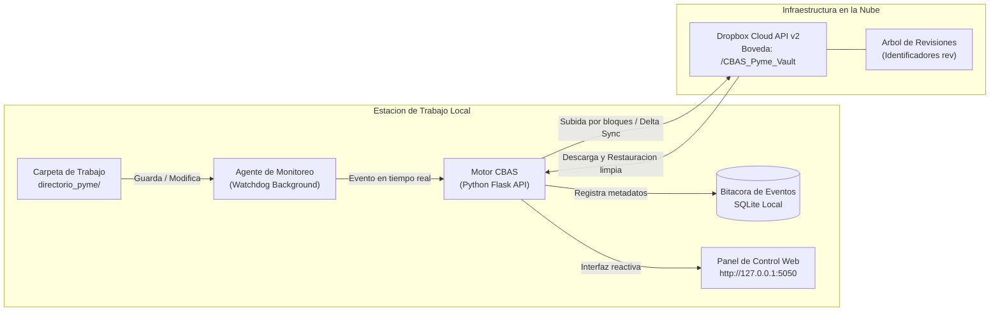

# CBAS — Cloud Backup & Audit System

Sistema de almacenamiento desacoplado, control continuo de versiones y recuperación ante fallos para pequeñas y medianas empresas (PYMEs), respaldado sobre la infraestructura en la nube de Dropbox Cloud API v2.

---

## 1. Descripcion General del Proyecto

**CBAS (Cloud Backup & Audit System)** es una plataforma de software diseñada para resolver de raíz el riesgo de pérdida de información, sobreescritura accidental o corrupción de documentos críticos en entornos corporativos y de oficina.

A diferencia de las herramientas convencionales de sincronización que copian archivos ciegamente, CBAS opera bajo una arquitectura de **Almacenamiento como Servicio (STaaS)** y **Desacoplamiento de Almacenamiento**. Un agente de software en segundo plano vigila la carpeta de trabajo, calcula la huella de integridad de cada archivo y gestiona automáticamente las versiones en la nube a través de la API oficial de Dropbox, garantizando trazabilidad completa y recuperación en un clic.

### Arquitectura de Funcionamiento



---

## 2. Que Hace el Sistema (Funcionalidades Principales)

### A. Versionado Automatico Continuo
* **Monitoreo en tiempo real:** Detecta de forma instantanea cada vez que un usuario guarda o modifica un archivo en `directorio_pyme/`.
* **Cero archivos duplicados:** No crea copias desordenadas (`archivo_v1`, `archivo_final`). En el disco de la computadora y en Dropbox existe un solo archivo limpio; las versiones anteriores quedan custodiadas bajo el identificador único de revisión (`rev`) de la nube.
* **Soporte multiformato:** Visualización y comparación directa de documentos Word (`.docx`), planillas Excel/CSV, documentos de texto (`.txt`, `.md`), código fuente (`.json`, `.py`, `.sql`) e imágenes.

### B. Eficiencia de Red y Almacenamiento (Delta Sync)
* **Deduplicacion por bloques:** Calcula hashes de 4 MB para identificar con precisión qué porción del archivo cambió.
* **Ahorro de ancho de banda:** Si un archivo grande sufre una modificación menor, el sistema evita volver a transferir información redundante consumiendo el mínimo de internet.

### C. Trazabilidad y Registro de Actividad
* **Metadatos de cada operacion:** Registra fecha y hora en UTC, usuario del sistema operativo, nombre del equipo en red, identificador de revisión y hash de integridad.
* **Resumen de actividad imprimible:** Genera un documento formal en formato de hoja de control con las operaciones registradas y espacios para firmas de conformidad.

### D. Hitos Inmutables y Proteccion de Documentos
* **Marcado de hitos:** Permite congelar versiones clave (ej. balances presentados a impuestos o contratos firmados). Los hitos quedan blindados y nunca se eliminan en limpiezas de almacenamiento.
* **Aviso ante modificaciones:** Si un documento marcado como auditado es modificado en disco, el sistema levanta una alerta de seguridad inmediata.

### E. Salud y Recuperacion Asistida en 1 Clic
* **Deteccion de discrepancias:** Compara la huella digital del archivo local contra la copia oficial en Dropbox Cloud para detectar daños, virus o ediciones no autorizadas.
* **Restauracion instantanea:** Si un archivo se corrompe o es alterado indebidamente, el sistema descarga la version sana de la nube y repara el archivo local de forma automatica.

---

## 3. Por Que CBAS y no un Sincronizador Tradicional

Para comprender el valor de CBAS frente a soluciones comunes de sincronización de carpetas:

| Aspecto | Sincronizador Comun (Escritorio) | CBAS (Cloud Backup & Audit System) |
| :--- | :--- | :--- |
| **Integracion** | Aplicacion de escritorio convencional instalada. | Comunicacion directa con Dropbox API v2 mediante OAuth 2.0. |
| **Control de Versiones** | Sobreescribe el archivo en la nube de forma ciega. | Registra un historico de versiones continuo con visor de diferencias (*diff*). |
| **Orden de Archivos** | Tiende a duplicar copias (`archivo_final_v2.docx`). | Mantiene un unico archivo limpio y gestiona las versiones en el backend de la nube. |
| **Trazabilidad** | No registra quien modifico el archivo en la red local. | Almacena usuario del sistema operativo, equipo, fecha UTC y revision de nube. |
| **Resiliencia ante Danos** | Si un virus altera el archivo local, el dano sube a la nube. | Detecta la discrepancia contra la nube y permite restaurar la version sana en 1 clic. |
| **Hitos Formales** | No distingue entre un borrador y un documento definitivo. | Permite fijar hitos inmutables que quedan protegidos contra podas de espacio. |

---

## 4. Modulos de la Interfaz Web

El panel se organiza en 3 pantallas intuitivas accesibles desde cualquier navegador:

1. **Explorador y Versiones:** Panel principal donde se listan los archivos monitoreados con sus iconos correspondientes, visor de contenido, comparador de cambios (*diff*) y opciones de restauracion o fijacion de hitos.
2. **Bitacora de Actividad:** Historial cronologico de todos los movimientos (archivos creados, modificados o restaurados), tarjetas de ahorro de red y generador del **Resumen de Actividad Imprimible**.
3. **Salud y Recuperacion:** Semáforo en tiempo real de la conexion con Dropbox, tabla de comprobacion de integridad archivo por archivo, laboratorio de prueba asistida de recuperacion y optimizador de versiones (poda).

---

## 5. Puesta en Marcha Rapida

Para levantar el sistema en cualquier ordenador (Windows, Linux o macOS):

1. **Requisitos:** Tener instalado Python 3.11 o superior y Git.
2. **Guia de Instalacion Completa:** Sigue el paso a paso detallado en [INSTALL.md](INSTALL.md).
3. **Resumen de comandos basicos:**
   ```bash
   # 1. Clonar el repositorio
   git clone https://github.com/d-dannyc/com-nube.git
   cd com-nube

   # 2. Crear y activar entorno virtual (Windows)
   python -m venv .venv
   .\.venv\Scripts\activate

   # 3. Instalar dependencias
   pip install -r requirements.lock.txt

   # 4. Vincular con Dropbox mediante el asistente interactivo
   python scripts/setup_oauth.py

   # 5. Iniciar la aplicacion
   python run_cbas.py
   ```
4. Abre tu navegador en **http://127.0.0.1:5050**.

---

## 6. Estructura del Repositorio

```text
com-nube/
├── cbas/                   # Paquete principal de la aplicacion
│   ├── agent.py            # Observador de archivos en segundo plano (Watchdog)
│   ├── backend.py          # API REST y servidor web Flask
│   ├── config.py           # Configuracion de rutas y variables de entorno
│   ├── database.py         # Capa de datos SQLite para auditoria
│   ├── documents.py        # Extractor y visor de documentos (.docx, texto, etc.)
│   ├── dropbox_service.py  # Cliente oficial Dropbox API v2 y logica de revisiones
│   ├── hasher.py           # Calculo de bloques SHA-256 compatibles con Dropbox
│   ├── static/             # Frontend: estilos (dashboard.css) y logica (dashboard.js)
│   └── templates/          # Plantilla HTML semantica (dashboard.html)
├── directorio_pyme/        # Carpeta local monitoreada de trabajo
├── scripts/
│   ├── setup_oauth.py      # Asistente interactivo de credenciales Dropbox
│   └── check_dropbox.py    # Script de verificacion de conexion cloud
├── tests/                  # Suite de 38 pruebas unitarias automatizadas
├── INSTALL.md              # Guia detallada de instalacion y configuracion paso a paso
├── README.md               # Descripcion del sistema y arquitectura
└── run_cbas.py             # Punto de entrada unificado para iniciar servidor y agente
```
