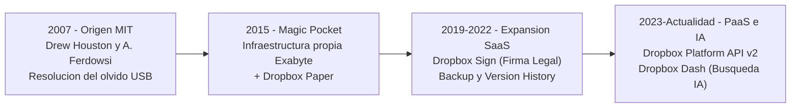
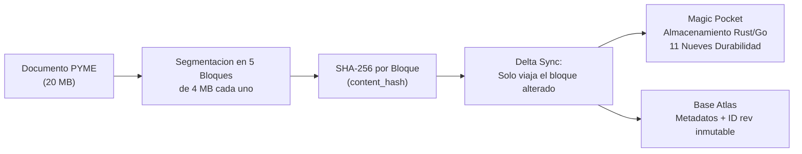
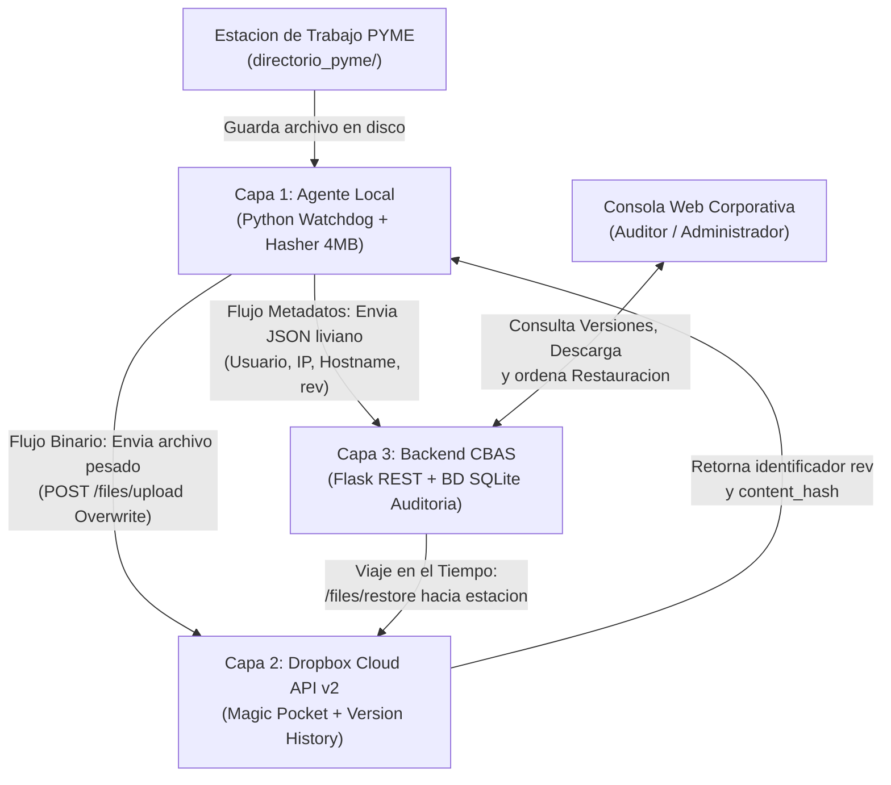
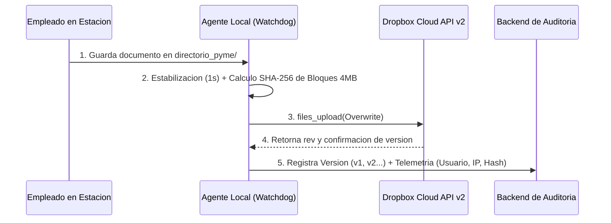
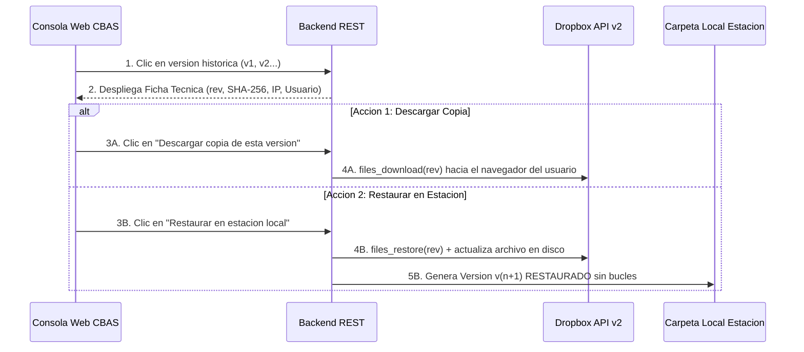

# Guia de Estructuracion de Diapositivas: Cloud Backup and Audit System (CBAS)

Este documento constituye el manual de diseno, organizacion y exposicion para construir las **15 diapositivas** de defensa del proyecto **Cloud Backup and Audit System (CBAS)** del Grupo N° 2 (Materia: Computacion en la Nube INF-318, Universidad Mayor de San Andres - UMSA, Docente: Ph.D. Jose Maria Tapia Baltazar).

El contenido esta estructurado de acuerdo a la rubrica academica y syllabus de evaluacion de la materia:
1. **Primera Parte (30% de la nota):**
   - Caratula Oficial
   - Introduccion
   - Marco Teorico (de 3 a 10 hojas en el informe digital, sintetizado en 3 diapositivas visuales de alto impacto)
   - Problematica - Identificacion del problema puntual
   - Problemas especificos
   - Objetivos (Relacion puntual 1 a 1 entre problemas y objetivos especificos)
2. **Segunda Parte: Desarrollo Practico de Cada Aplicacion o Servicio (70% de la nota):**
   - Arquitectura desacoplada (Storage Decoupling)
   - Flujo A: Respaldo por guardado y telemetria en tiempo real
   - Flujo B: Consulta de ficha tecnica, descarga directa y restauracion en estacion de trabajo
   - Seguridad y Confinamiento en Dropbox App Console (OAuth 2.0 y Scopes)
   - Demostracion del producto entregable: Consola web corporativa Open Enterprise
   - Demostracion en accion: Inspeccion de versiones historicas, descarga y restauracion real
   - Pista de auditoria de red y gobernanza TI con Dropbox Paper y Dropbox Sign
3. **Tercera Parte: Entrega Final al 100%:**
   - Documento digital entregado al 100% con todos los detalles de cada servicio
   - Conclusiones tecnicas y paso a la demostracion en vivo

---

## Lineamientos Generales de Diseno Visual y Dinamismo

1. **Regla 6x6 y Cero Sobrecarga de Texto:** Ninguna diapositiva debe contener parrafos densos copiados del informe. En pantalla solo deben figurar tarjetas visuales, diagramas de flujo, tablas comparativas y capturas reales del sistema en ejecucion.
2. **Paleta de Colores Sugerida (Open Enterprise Tech):**
   - Fondo blanco corporativo (#FBF9F9) o fondo oscuro ejecutivo (#151515).
   - Acento primario en Rojo Corporativo (#EE0000) para llamadas de atencion y botones clave.
   - Acento secundario en Azul Dropbox (#0061FF) para identificar servicios de la plataforma.
   - Tipografia recomendada: IBM Plex Sans para titulos y textos, e IBM Plex Mono para identificadores tecnicos y hashes.
3. **Distribucion del Tiempo (15 a 20 minutos entre los 4 integrantes):**
   - **Bloque 1 (30%):** Diapositivas 1 a 7 (Expositores 1 y 2 - 7 minutos).
   - **Bloque 2 (70%):** Diapositivas 8 a 14 (Expositores 3 y 4 - 9 minutos).
   - **Bloque 3 (100%):** Diapositiva 15 y Demostracion en Vivo (Equipo completo - 4 minutos).

---

## BLOQUE I: PRIMERA PARTE - FUNDAMENTACION TEORICA Y PROBLEMATICA (30%)

### Diapositiva 1: Caratula Institucional y Presentacion del Proyecto

- **Seccion del Syllabus:** Caratula (Primera Parte - 30%).
- **Instruccion de Diseno Visual:** Diseno limpio y sobrio a dos columnas. En la columna izquierda, escudo oficial de la UMSA y de la Carrera de Informatica, titulo destacado del sistema CBAS y datos institucionales del docente. En la columna derecha, tarjeta con el logotipo de Dropbox Cloud Platform y una vista previa reducida de la Consola Web CBAS.
- **Texto en Pantalla:**
  - Universidad Mayor de San Andres - Facultad de Ciencias Puras y Naturales
  - Carrera de Informatica | Materia: Computacion en la Nube (INF-318)
  - Docente: Ph.D. Jose Maria Tapia Baltazar
  - Titulo del Proyecto: **Cloud Backup and Audit System (CBAS)**
  - Subtitulo: Sistema de Respaldo Descentralizado y Control de Versiones para PYMEs basado en Dropbox Cloud API
  - Grupo N° 2:
    - Saul Mijael Choquehuanca Huanca
    - Carlos Daniel Quispe Chambi
    - Victor Bernardo Quispe Rojas
    - Gabriel Yujra Machaca
- **Guion de Explicacion Oral:**
  "Buenos dias Doctor y companeros. Somos el Grupo Numero 2 de la materia Computacion en la Nube. Nuestra plataforma asignada es Dropbox. Hoy expondremos la fundamentacion teorica de esta tecnologia cloud y el desarrollo practico de nuestro sistema: Cloud Backup and Audit System (CBAS), una solucion de respaldo descentralizado, control de versiones y auditoria de red en tiempo real orientado a Pequenas y Medianas Empresas."

---

### Diapositiva 2: Introduccion y Justificacion del Proyecto

- **Seccion del Syllabus:** Introduccion (Primera Parte - 30%).
- **Instruccion de Diseno Visual:** Presentar una infografia visual dividida en 3 pilares clave: El Entorno PYME (Vulnerabilidad), El Dilema Tecnologico (Git vs. AWS S3) y La Solucion Hibrida CBAS.
- **Texto en Pantalla (3 Tarjetas Resumen):**
  - **1. La Realidad de las PYMEs:** Manejan documentos criticos (balances, planillas, contratos) en carpetas locales vulnerables a sobrescritura accidental y ataques de ransomware.
  - **2. La Brecha de las Alternativas Actuales:** Git es excesivamente complejo para personal no tecnico; contratar y programar almacenamiento desde cero en AWS S3 o Azure Blob resulta costoso y dificil de mantener.
  - **3. Propuesta de Valor CBAS:** Arquitectura hibrida que desacopla el almacenamiento masivo (delegado a Dropbox) de la telemetria y auditoria (gestionada por un backend liviano).
- **Guion de Explicacion Oral:**
  "Iniciando con la introduccion del proyecto, las PYMEs enfrentan un dilema critico: perder informacion sensible por errores humanos o ransomware, sin tener trazabilidad de quien modifico que archivo. No es viable exigir a contadores o administradores dominar comandos de Git, ni una PYME dispone de presupuesto para arquitectos de AWS o Azure. CBAS resuelve esta brecha combinando la robustez masiva de Dropbox con un agente local automatizado y un panel web intuitivo de gestion."

---

### Diapositiva 3: Marco Teorico I - Que es Dropbox Realmente y su Evolucion Tecnologica

- **Seccion del Syllabus:** Marco teorico (Primera Parte - 30%).
- **Instruccion de Diseno Visual:** Linea de tiempo horizontal con 4 estaciones tecnicas que demuestran que Dropbox no es solo una carpeta de sincronizacion manual como Google Drive, sino una plataforma Cloud transaccional.
- **Diagrama Visual para Incluir en la Diapositiva:**

- **Texto en Pantalla:**
  - **Origen:** Fundada en 2007 en el MIT; hoy gestiona mas de 700 millones de usuarios y 575,000 clientes corporativos.
  - **Mas que almacenamiento personal:** Supero el paradigma de disco virtual pasivo para convertirse en una plataforma integral con infraestructura fisica propia, APIs programables y colaboracion empresarial.
  - **Transicion a Plataforma (PaaS):** Permite a sistemas externos utilizar su motor de bloques y su historial inmutable como base transaccional de software.
- **Guion de Explicacion Oral:**
  "Para iniciar el Marco Teorico es vital romper el mito comun: Dropbox no es simplemente una carpeta para subir archivos a mano como Google Drive. Nacio en 2007 en el MIT para eliminar la dependencia de memorias USB, pero evoluciono radicalmente hasta construir centros de datos propios y convertirse en una plataforma Cloud PaaS y SaaS con APIs de nivel empresarial, firma digital legal e integracion con modelos de inteligencia artificial."

---

### Diapositiva 4: Marco Teorico II - Fundamentos Cloud (NIST) y Arquitectura Interna de Dropbox

- **Seccion del Syllabus:** Marco teorico (Primera Parte - 30%).
- **Instruccion de Diseno Visual:** Esquema tecnico a dos columnas: en la izquierda los Fundamentos NIST SP 800-145 y Modelos IaaS/PaaS/SaaS; en la derecha la Arquitectura Interna de Dropbox (Magic Pocket y Delta Sync por bloques de 4 MB).
- **Diagrama Visual para Incluir en la Diapositiva:**

- **Texto en Pantalla:**
  - **Modelo NIST SP 800-145:** Autoservicio bajo demanda, amplio acceso de red, comparticion elastica de recursos y servicio medido.
  - **Magic Pocket:** Sistema de almacenamiento exabyte disenado por Dropbox en Rust y Go con cifrado AES-256 en reposo y 99.999999999% de durabilidad anual.
  - **Sincronizacion Delta (4 MB):** Los archivos se dividen en fragmentos de 4 MB; si se modifica una hoja de calculo de 20 MB, solo viaja a la nube el bloque modificado.
  - **Versionado rev sin costo de espacio:** Cada cambio crea una revision inmutable identificada por su codigo rev que no consume cuota de almacenamiento del usuario.
- **Guion de Explicacion Oral:**
  "En el ambito teorico de Computacion en la Nube, Dropbox opera bajo el estandar NIST SP 800-145 como PaaS y SaaS. Su mayor innovacion es Magic Pocket, su arquitectura de almacenamiento en Rust y Go con once nueves de durabilidad, y su algoritmo Delta Sync, que segmenta cualquier archivo en bloques de 4 megabytes con firmas SHA-256. Esto permite respaldar archivos al instante sin saturar el ancho de banda y conservar un arbol inmutable de revisiones rev sin consumir cuota adicional."

---

### Diapositiva 5: Marco Teorico III - Catalogo Completo de Servicios del Ecosistema Dropbox

- **Seccion del Syllabus:** Marco teorico (Primera Parte - 30%).
- **Instruccion de Diseno Visual:** Mosaico de 8 tarjetas tecnologicas organizadas por capas de servicio, destacando con borde rojo las que alimentan directamente a CBAS.
- **Texto en Pantalla (Catalogo de 8 Servicios Oficiales):**
  1. **Dropbox Core Storage:** Custodia distribuida de archivos binarios con cifrado AES-256 en reposo y TLS en transito.
  2. **Dropbox Platform (API v2):** Interfaz programable REST y SDK de Python para automatizar subidas, descargas y consultas.
  3. **Version History y Rewind:** Motor de revisiones continuas rev que registra cada modificacion historica.
  4. **Smart Sync / Archivos solo en linea:** Sincronizacion bajo demanda que no satura el disco local de la maquina.
  5. **Dropbox Paper:** Espacio colaborativo para bitacoras, manuales y acuerdos de equipo.
  6. **Dropbox Sign (antes HelloSign):** Firma electronica con validez juridica y pista de auditoria forense.
  7. **Dropbox Dash:** Motor de busqueda universal e indexacion inteligente con IA.
  8. **Dropbox DocSend y Transfer:** Transferencia cifrada de archivos pesados con control de lectura y caducidad.
- **Guion de Explicacion Oral:**
  "Como exige la guia de la materia, no analizamos un producto aislado sino todo el ecosistema. Dropbox ofrece ocho servicios fundamentales: desde el almacenamiento cifrado y la API v2 que usamos como motor del software, hasta herramientas de gobernanza corporativa como Dropbox Paper para documentacion y Dropbox Sign para actas con validez legal."

---

### Diapositiva 6: Problematica e Identificacion del Problema Puntual en PYMEs

- **Seccion del Syllabus:** Problematica - Identificacion del problema puntual y Problemas especificos (Primera Parte - 30%).
- **Instruccion de Diseno Visual:** Panel dividido en dos secciones: a la izquierda el Problema Puntual Central y a la derecha los 4 Problemas Especificos diagnosticados en las empresas.
- **Texto en Pantalla:**
  - **Problema Puntual Central:**
    Las PYMEs carecen de un sistema automatizado y amigable que garantice simultaneamente la recuperacion de archivos criticos ante errores humanos o ciberataques, y la auditoria forense sobre quien realizo cada modificacion en la red interna.
  - **Los 4 Problemas Especificos:**
    1. **Olvido y demora en respaldos manuales:** Los empleados no respaldan periodicamente sus documentos de trabajo.
    2. **Saturacion de red y almacenamiento redundante:** Subir archivos completos tras cada edicion satura el ancho de banda y llena los servidores locales.
    3. **Ausencia de auditoria de red:** No existe registro de que usuario del sistema operativo, IP o maquina modifico un archivo sensible.
    4. **Incapacidad de recuperacion rapida ante desastres:** Ante corrupcion o ransomware, la PYME no puede viajar en el tiempo para restaurar versiones limpias en segundos.
- **Guion de Explicacion Oral:**
  "Pasando a la problematica, identificamos un problema puntual grave: en una PYME promedio no existen mecanismos automatizados de respaldo ni trazabilidad de cambios. Los cuatro problemas especificos son contundentes: primero, el personal olvida hacer respaldos; segundo, cuando lo hacen manualmente saturan la red al copiar carpetas enteras; tercero, no queda registro de que empleado o que direccion IP altero un balance contable; y cuarto, ante un ataque de secuestro de datos la recuperacion es nula o requiere dias."

---

### Diapositiva 7: Objetivos del Proyecto (Relacion Directa 1 a 1 Problema - Objetivo)

- **Seccion del Syllabus:** Objetivo General y Especificos relacionados con el problema (Primera Parte - 30%).
- **Instruccion de Diseno Visual:** Tabla comparativa visual que demuestra la correspondencia matematica exacta 1 a 1 entre cada problema diagnosticado y el objetivo que lo soluciona.
- **Texto en Pantalla:**
  - **Objetivo General:** Desarrollar el sistema Cloud Backup and Audit System (CBAS) orientado a PYMEs, empleando Dropbox Cloud API como motor descentralizado de versionado por bloques y almacenamiento masivo, integrado con un agente local reactivo y una consola web corporativa de auditoria.

| Problema Especifico Diagnosticado | Objetivo Especifico (Solucion Planteada) |
| :--- | :--- |
| **1. Olvido de respaldos manuales** | **1. Agente Local en tiempo real:** Implementar monitoreo continuo con Python Watchdog que detecte guardados en disco sin intervencion del usuario. |
| **2. Saturacion de ancho de banda y red** | **2. Optimizacion por bloques de 4 MB:** Validar firmas SHA-256 locales con el content_hash de Dropbox API v2 para evitar trafico redundante. |
| **3. Ausencia de auditoria de cambios** | **3. Base de Metadatos de Red:** Registrar usuario del sistema, IP local, nombre del equipo, fecha UTC y codigo rev (ISO 27001 A.12.4). |
| **4. Incapacidad de recuperacion rapida** | **4. Panel Web con Viaje en el Tiempo:** Permitir descargar o restaurar en 1 clic cualquier version historica directamente en la estacion de trabajo. |

- **Guion de Explicacion Oral:**
  "Cumpliendo con el rigor academico solicitado por el docente, cada objetivo especifico responde de manera directa y vinculante a un problema especifico. Frente al olvido, creamos el agente Watchdog en tiempo real; frente a la saturacion de red, aprovechamos la sincronizacion por bloques de 4 megabytes; frente a la falta de auditoria, construimos una base de telemetria con estandares ISO 27001; y frente a la perdida de datos, disenamos el panel de restauracion en un clic."

---

## BLOQUE II: SEGUNDA PARTE - DESARROLLO PRACTICO Y PRODUCTO ENTREGABLE (70%)

### Diapositiva 8: Arquitectura Desacoplada del Sistema CBAS (Storage Decoupling)

- **Seccion del Syllabus:** Desarrollo practico de cada aplicacion o servicio (Segunda Parte - 70%).
- **Instruccion de Diseno Visual:** Diagrama arquitectonico central a pantalla completa que ilustra la separacion entre el flujo binario pesado hacia Dropbox y el flujo liviano de metadatos hacia el backend interno.
- **Diagrama Visual para Incluir en la Diapositiva:**

- **Texto en Pantalla (3 Principios Cloud Demostrados):**
  - **Storage Decoupling:** Nuestro servidor no aloja archivos pesados en local; solo gestiona metadatos, delegando el almacenamiento a la nube de Dropbox.
  - **Arquitectura Reactiva (Event-Driven):** El sistema reacciona a los eventos del sistema operativo sin tareas batch programadas.
  - **Aislamiento de Seguridad:** Confinamiento mediante OAuth 2.0 en alcance App Folder.
- **Guion de Explicacion Oral:**
  "Ingresando al 70% practico del proyecto, esta es la arquitectura implementada en CBAS. Demostramos el principio fundamental de Desacoplamiento de Almacenamiento en la Nube: el archivo binario pesado (sea un Word, PDF, CSV o JSON) viaja directamente desde el agente hacia la nube de Dropbox mediante su API v2. Dropbox almacena el archivo y nos devuelve el codigo inmutable rev. El agente unicamente envia un JSON de metadatos ligeros a nuestra base de datos interna, logrando una plataforma ultrarrapida y sin sobrecostos de servidor."

---

### Diapositiva 9: Flujo de Trabajo A - Respaldo por Guardado y Telemetria en Tiempo Real

- **Seccion del Syllabus:** Desarrollo practico de cada aplicacion o servicio (Segunda Parte - 70%).
- **Instruccion de Diseno Visual:** Diagrama de secuencia temporal con los 5 pasos que ejecuta el Agente Local cuando un empleado guarda un documento en su estacion de trabajo.
- **Diagrama de Secuencia para Incluir en la Diapositiva:**

- **Texto en Pantalla:**
  - **Versionado por Guardado:** No se crean versiones intermedias mientras el usuario escribe, sino cuando confirma el guardado en disco tras 1 segundo de estabilizacion (debounce).
  - **Algoritmo de Bloques de 4 MB:** Calcula localmente el content_hash; si coincide con la ultima revision registrada, se descarta para evitar trafico redundante.
  - **Captura de Telemetria:** Registra usuario real del sistema operativo, IP local y nombre de maquina.
- **Guion de Explicacion Oral:**
  "El primer flujo operativo es el respaldo automatico. Cuando un empleado guarda una hoja contable o informe, Watchdog espera un segundo para confirmar que la aplicacion termino de escribir en disco, calcula la firma criptografica de bloques de 4 megabytes y sube el archivo a Dropbox. Dropbox genera una nueva revision rev y el agente envia la telemetria completa de red al panel de auditoria."

---

### Diapositiva 10: Flujo de Trabajo B - Consulta de Ficha Tecnica, Descarga Directa y Restauracion

- **Seccion del Syllabus:** Desarrollo practico de cada aplicacion o servicio (Segunda Parte - 70%).
- **Instruccion de Diseno Visual:** Esquema de dos rutas paralelas que ofrece la consola web al auditor o usuario: Ruta A (Descargar copia) vs. Ruta B (Restaurar en estacion).
- **Diagrama de Secuencia para Incluir en la Diapositiva:**

- **Texto en Pantalla:**
  - **Inspeccion Inmediata:** Despliegue instantaneo de metadatos sin descargar el archivo completo.
  - **Descarga Directa:** Permite obtener el documento historico en el navegador para verificacion previa sin modificar la carpeta de trabajo.
  - **Restauracion Transaccional:** Invoca files_restore en Dropbox Cloud, actualiza la estacion local y previene bucles de sincronizacion infinitos.
- **Guion de Explicacion Oral:**
  "El segundo flujo resuelve la recuperacion ante desastres. Al hacer clic sobre cualquier version historica, el panel muestra su ficha tecnica con el codigo rev, firma SHA-256, usuario e IP de origen. Desde alli el usuario tiene dos opciones: descargar directamente esa version historica al navegador para examinarla sin alterar la carpeta, o restaurarla directamente en su estacion de trabajo con un solo clic."

---

### Diapositiva 11: Seguridad Cloud - Dropbox App Console y OAuth 2.0 Scoped Access

- **Seccion del Syllabus:** Desarrollo practico de cada aplicacion o servicio (Segunda Parte - 70%).
- **Instruccion de Diseno Visual:** Composicion visual con la credencial de aplicacion registrada en Dropbox Developers y un diagrama de los 4 permisos minimos requeridos.
- **Texto en Pantalla:**
  - **Aplicacion Registrada:** CloudBackup-UMSA-G2 (App Key: 8806881).
  - **Aislamiento por Confinamiento:** Tipo App Folder (/Aplicaciones/CloudBackup-UMSA-G2/CBAS_Pyme_Vault); el sistema no tiene acceso al resto de la cuenta del usuario.
  - **Permisos Minimos (Principio de Menor Privilegio):**
    - files.content.write (Subir archivos y crear versiones)
    - files.content.read (Descargar versiones historicas)
    - files.metadata.read (Consultar historial rev y atributos)
    - account_info.read (Validar cuota y estado de la cuenta)
  - **Autenticacion Continua:** Flujo OAuth 2.0 con Refresh Token permanente para operacion ininterrumpida sin caducidad de sesion.
- **Guion de Explicacion Oral:**
  "Para garantizar la seguridad de la informacion de la PYME, implementamos el principio de privilegio minimo. En la consola de Dropbox Developers creamos una aplicacion con ambito exclusivo App Folder, restringiendo su radio de accion a una unica carpeta y habilitando solo cuatro permisos especificos. Mediante un Refresh Token OAuth 2.0, el agente opera de forma autonoma y continua sin exponer contrasenas en el codigo."

---

### Diapositiva 12: Demostracion del Producto - Consola Web Corporativa Open Enterprise

- **Seccion del Syllabus:** Desarrollo practico de cada aplicacion o servicio (Segunda Parte - 70%).
- **Instruccion de Diseno Visual:** Diapositiva protagonizada por la **Captura Real 1 del Producto** ([cbas_dashboard_general.png](file:///home/carloos-odann/PROYECTOS/UNI-VERSALIDAD/COM-NUBE/proyecto-dropbox/docs/capturas/cbas_dashboard_general.png)) ocupando el 75% del espacio, acompanada de tres indicadores tecnicos.
- **Elementos Destacados en la Captura:**
  - **Diseno Sobrio Open Enterprise Tech:** Estilo visual inspirado en lineas corporativas tecnicas (fondos claros #FBF9F9, tipografia IBM Plex Sans e IBM Plex Mono, acentos en rojo #EE0000).
  - **Metricas Globales de Nube:** Barra superior que reporta 4.72 megabytes custodiados en Dropbox Cloud Platform, 8 archivos sincronizados y 16 versiones historicas.
  - **Soporte Multiformato Real:** Reconocimiento y clasificacion de documentos ofimaticos (Word .docx, PDF), datos estructurados (CSV, JSON) y notas tecnicas (Markdown).
- **Guion de Explicacion Oral:**
  "Aqui apreciamos nuestro producto entregable en ejecucion real. La interfaz fue construida con una estetica empresarial sobria y de alta legibilidad con tipografia IBM Plex. En la cabecera muestra en tiempo real los 4.72 megabytes custodiados en Dropbox, la boveda de documentos y la ficha tecnica de cada version, permitiendo auditar archivos binarios de oficina como Word o PDF con la misma precision que archivos de base de datos."

---

### Diapositiva 13: Demostracion en Accion - Inspeccion de Versiones, Descarga y Restauracion

- **Seccion del Syllabus:** Desarrollo practico de cada aplicacion o servicio (Segunda Parte - 70%).
- **Instruccion de Diseno Visual:** Comparativa lado a lado con las capturas reales del sistema: a la izquierda la inspeccion de version y telemetria ([cbas_alerta_ransomware.png](file:///home/carloos-odann/PROYECTOS/UNI-VERSALIDAD/COM-NUBE/proyecto-dropbox/docs/capturas/cbas_alerta_ransomware.png)) y a la derecha la restauracion completada en disco ([cbas_restauracion_exitosa.png](file:///home/carloos-odann/PROYECTOS/UNI-VERSALIDAD/COM-NUBE/proyecto-dropbox/docs/capturas/cbas_restauracion_exitosa.png)).
- **Texto en Pantalla (Caso de Prueba Real Verificado):**
  - **Archivo de Prueba:** Configuracion_ERP_Pyme.json
  - **Version v1 Original:** rev 0165ec03f88fc830000000332488fd1 (232 bytes, parametros integros)
  - **Version v2 con Alteracion:** rev 0165ec0401043400000000332488fd1 (89 bytes, archivo truncado por error)
  - **Version v3 Recuperada desde v1:** rev 0165ec0404ef7390000000332488fd1 (232 bytes restablecidos en estacion de trabajo)
- **Guion de Explicacion Oral:**
  "En esta diapositiva demostramos la funcionalidad en accion con un caso real. A la izquierda, un archivo de configuracion sufrio una modificacion indebida; la ficha tecnica muestra el rev, el hash y que el usuario carloos-odann realizo el cambio. Al pulsar Restaurar, Dropbox revierte la revision y descarga el contenido original en la carpeta local, generando la Version v3 que vemos a la derecha con los 232 bytes totalmente recuperados."

---

### Diapositiva 14: Pista de Auditoria de Red y Gobernanza TI con Dropbox Paper y Sign

- **Seccion del Syllabus:** Desarrollo practico de cada aplicacion o servicio (Segunda Parte - 70%).
- **Instruccion de Diseno Visual:** Captura real de la seccion **Registro de Auditoria** ([cbas_acta_auditoria_sign.png](file:///home/carloos-odann/PROYECTOS/UNI-VERSALIDAD/COM-NUBE/proyecto-dropbox/docs/capturas/cbas_acta_auditoria_sign.png)) complementada con tarjetas de articulacion con Dropbox Paper y Dropbox Sign.
- **Texto en Pantalla:**
  - **Pista de Auditoria de Red (ISO/IEC 27001 A.12.4 & COBIT):** Registro inmutable de cada evento (CREADO, MODIFICADO, RESTAURADO) con fecha UTC, usuario del sistema operativo, IP de origen (192.168.21.78) y revision rev de Dropbox.
  - **Dropbox Paper:** Gestion colaborativa de la bitacora de cambios y manual de procedimientos del departamento de TI.
  - **Dropbox Sign:** Emision y firma electronica con validez juridica del acta de conformidad de auditoria de respaldos.
- **Guion de Explicacion Oral:**
  "En la pestana de Auditoria disponemos de la pista forense completa requerida por normas ISO 27001 y COBIT, identificando fehacientemente que usuario de red y desde que IP se realizo cada modificacion o recuperacion. Toda esta trazabilidad se articula con Dropbox Paper para la bitacora de administracion y con Dropbox Sign para la firma legal del acta de auditoria."

---

## BLOQUE III: TERCERA PARTE - ENTREGA FINAL AL 100% Y CONCLUSIONES

### Diapositiva 15: Entrega Final al 100%, Conclusiones y Demostracion en Vivo

- **Seccion del Syllabus:** Entrega final al 100% (Documento digital con todos los detalles de cada aplicacion y servicio).
- **Instruccion de Diseno Visual:** Tres tarjetas de verificacion que constatan el 100% de cumplimiento del proyecto academico y un recuadro central de invitacion a la prueba en vivo.
- **Texto en Pantalla:**
  - **1. Documento Digital Completo (100%):**
    - Informe academico Proyecto-CC.md con mas de 10 hojas de Marco Teorico, analisis NIST, arquitectura Magic Pocket, gobierno de TI ISO 27001 y detalle exhaustivo del 70% practico.
  - **2. Cobertura Integral del Ecosistema Dropbox:**
    - Implementacion activa de Dropbox Platform API v2, Core Storage, Delta Sync por bloques de 4 MB, Version History rev, Dropbox Paper y Dropbox Sign.
  - **3. Conclusiones del Proyecto:**
    - Dropbox demuestra ser una plataforma cloud PaaS transaccional altamente eficiente y no un mero repositorio pasivo.
    - La arquitectura desacoplada brinda custodia ligera y de alto desempeno para PYMEs.
    - La continuidad del negocio se garantiza mediante la recuperacion en un clic con trazabilidad total.
- **Guion de Explicacion Oral:**
  "Para concluir con la entrega final al 100%, nuestro proyecto cumple la totalidad de los requisitos: presentamos el documento digital exhaustivo con todos los fundamentos de la nube y los detalles de cada servicio, y un software plenamente operativo. A continuacion, el servidor y la carpeta asociada estan listos para editar cualquier documento en vivo y comprobar la descarga y restauracion instantanea. Muchas gracias."
